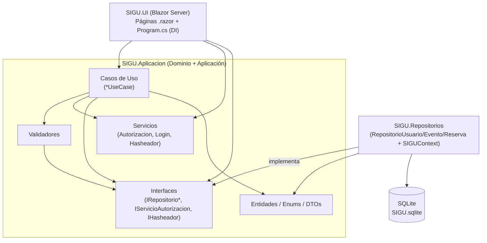
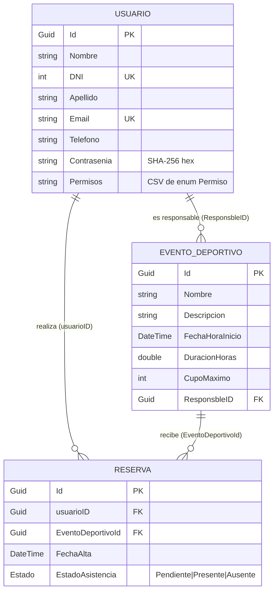

# SIGU

**Sistema de Gestión del Centro Deportivo Universitario** — aplicación web para administrar usuarios, eventos deportivos y reservas (inscripciones) de un centro deportivo universitario.

> Nota sobre el nombre: la solución, los proyectos y el título de la página `Home` usan **SIGU** / "Sistema de Gestión del Centro Deportivo Universitario". El logo del menú de navegación muestra la sigla **SGCDU**. Se trata del mismo sistema.

---

## 1. Overview

**Qué es.** SIGU es una aplicación Blazor Server (.NET 8) que permite gestionar el ciclo de vida de tres entidades: usuarios, eventos deportivos y reservas. Un usuario inicia sesión, puede inscribirse a eventos con cupo disponible, ver y cancelar sus reservas y modificar su perfil. Los usuarios con permisos administrativos pueden además dar de alta/baja/modificar usuarios y eventos, y consultar listados globales.

**Problema que resuelve.** Centraliza el registro de personas, la publicación de eventos deportivos con cupo limitado y la inscripción/asistencia a esos eventos, reemplazando gestión manual en planillas.

**Funcionalidades principales** (todas verificadas en el código):

- Registro de usuarios y login con contraseña hasheada (SHA-256).
- Gestión de usuarios (alta, baja, modificación, listado) sujeta a permisos.
- Gestión de eventos deportivos (alta, baja, modificación, listado).
- Listado de eventos **con cupo disponible** e inscripción a ellos.
- Gestión de reservas (listado, baja/cancelación, modificación).
- "Mis inscripciones": reservas propias del usuario logueado.
- Listado de asistentes presentes a un evento.
- Sistema de permisos granular por acción (enum `Permiso`).

**Estado actual.** Proyecto académico funcional. Rama activa: `Produccion`. No hay tests, ni Docker, ni CI/CD, ni migraciones de EF Core (el esquema se crea con `EnsureCreated`). Ver [§19 Technical Debt](#19-technical-debt--observaciones) para limitaciones relevantes de seguridad y correctitud.

---

## 2. Tech Stack

| Tecnología | Versión | Propósito |
| ---------- | ------- | --------- |
| .NET / C# | net8.0 | Framework y runtime de los tres proyectos |
| ASP.NET Core Blazor (Server) | 8.0 (`Microsoft.NET.Sdk.Web`) | UI web con `InteractiveServerComponents` |
| Entity Framework Core | 8.0.0 | ORM de persistencia |
| EF Core SQLite provider (`Microsoft.EntityFrameworkCore.Sqlite`) | 8.0.0 | Base de datos embebida SQLite |
| Bootstrap | 5.x (`wwwroot/lib/bootstrap`, incluido en el repo) | Estilos de la UI |
| `System.Security.Cryptography.SHA256` | BCL .NET 8 | Hasheo de contraseñas |
| `System.ComponentModel.DataAnnotations` | BCL .NET 8 | Validaciones declarativas en DTOs |

> **No** se detectaron: autenticación ASP.NET Identity, JWT, migraciones EF Core, paquetes de logging externos, ni frameworks de testing. `AddAuthorizationCore()` está registrado en `Program.cs` pero el sistema **no** usa el pipeline de autenticación/autorización de ASP.NET (ver [§12](#12-autenticación-y-autorización)).

---

## 3. Requisitos

- **SDK:** .NET SDK 8.0 (los tres `.csproj` fijan `TargetFramework net8.0`).
- **IDE recomendado:** Visual Studio 2022 (la solución declara `VisualStudioVersion = 17.0`) o cualquier editor con soporte C# (VS Code + C# Dev Kit, JetBrains Rider).
- **Base de datos:** SQLite. No requiere servidor externo; el archivo `SIGU.sqlite` se crea automáticamente en el primer arranque. El provider ya viene como dependencia NuGet.
- **Herramientas:** CLI `dotnet` (incluida en el SDK). No se requieren `dotnet-ef` tools porque **no hay migraciones**.
- **Sistema operativo:** cualquiera soportado por .NET 8 (Windows, Linux, macOS).

---

## 4. Instalación y ejecución

```text
clonar → restaurar → (sin configuración obligatoria) → ejecutar (la DB se crea sola)
```

```bash
git clone <URL-del-repositorio>
cd SIGU/SIGU
```

```bash
dotnet restore SIGU.sln
```

```bash
dotnet build SIGU.sln
```

Ejecutar la aplicación web (proyecto de arranque = `SIGU.UI`):

```bash
dotnet run --project SIGU.UI/SIGU.UI.csproj
```

La app queda disponible en **http://localhost:5233** (definido en `SIGU.UI/Properties/launchSettings.json`, perfil `http`, `ASPNETCORE_ENVIRONMENT=Development`, sin HTTPS configurado).

**Preparación de la base de datos.** No hay pasos manuales: al iniciar, `Program.cs` ejecuta `DatabaseSqlite.Inicializar(context)` que llama a `context.Database.EnsureCreated()`, activa `PRAGMA foreign_keys = ON` y fija `journal_mode = DELETE`. El archivo se crea en la ruta `Data Source=../SIGU.Repositorios/SIGU.sqlite` **relativa al directorio de trabajo del proceso UI**.

- **Migraciones:** ausentes (se usa `EnsureCreated`, no `Migrate`). Cambios de esquema requieren borrar el `.sqlite` y volver a arrancar.
- **Seeds:** ausentes. La base arranca vacía.
- **Primer usuario = administrador.** `RegisterUseCase` detecta si la tabla `Usuario` está vacía; si es el primer registro, le asigna **todos** los permisos (`Enum.GetValues<Permiso>()`). Por lo tanto, el primer usuario registrado desde `/Registrarse` queda como administrador total.
- **Variables de entorno / certificados / servicios externos:** ninguno requerido.

### Ruta de la base de datos (importante)

La cadena de conexión `../SIGU.Repositorios/SIGU.sqlite` se resuelve respecto del **working directory**. Con `dotnet run --project SIGU.UI/...` ejecutado desde `SIGU/SIGU`, el working directory suele ser el del proyecto UI, por lo que el archivo se crea en `SIGU/SIGU.Repositorios/SIGU.sqlite`. Si se ejecuta el binario publicado desde otra carpeta, la ruta relativa cambiará. El patrón `*/*.sqlite` está en `.gitignore`, de modo que la base **no** se versiona.

---

## 5. Configuración

| Archivo | Contenido relevante |
| ------- | ------------------- |
| `SIGU.UI/appsettings.json` | Niveles de logging (`Default: Information`, `Microsoft.AspNetCore: Warning`) y `AllowedHosts: "*"`. |
| `SIGU.UI/appsettings.Development.json` | Sólo overrides de logging. |
| `SIGU.UI/Properties/launchSettings.json` | Perfil `http` → `applicationUrl: http://localhost:5233`, `ASPNETCORE_ENVIRONMENT=Development`, `launchBrowser: true`. |
| `SIGU.UI/Program.cs` | Cadena de conexión SQLite **hardcodeada** y registro de todos los servicios (DI). |

> La cadena de conexión **no** está en `appsettings.json`: está embebida en `Program.cs` (`options.UseSqlite("Data Source=../SIGU.Repositorios/SIGU.sqlite")`). No hay secretos en el repositorio (la DB es local y las contraseñas se almacenan hasheadas).

---

## 6. Arquitectura

SIGU implementa una **arquitectura por capas con inversión de dependencias** (estilo Clean Architecture "aplanado"). Hay **tres** proyectos, no cuatro: el dominio y la capa de aplicación conviven en un mismo proyecto (`SIGU.Aplicacion`).

| Proyecto | Rol | Depende de |
| -------- | --- | ---------- |
| **SIGU.Aplicacion** | Núcleo: entidades de dominio, enums, DTOs, **interfaces** de repositorio, servicios, validadores, casos de uso y excepciones. Sin dependencias de infraestructura. | (nada — sólo BCL) |
| **SIGU.Repositorios** | Infraestructura de persistencia: `SIGUContext` (EF Core) e implementaciones concretas de los repositorios. | `SIGU.Aplicacion`, `EFCore.Sqlite` |
| **SIGU.UI** | Presentación: aplicación Blazor Server, páginas `.razor`, layout, y composición de la inyección de dependencias en `Program.cs`. | `SIGU.Aplicacion`, `SIGU.Repositorios` |

**Dirección de dependencias.** `Repositorios → Aplicacion` y `UI → {Aplicacion, Repositorios}`. La capa de aplicación **no** referencia a la de infraestructura: define interfaces (`IRepositorioUsuario`, `IRepositorioEventoDeportivo`, `IRepositorioReserva`, `IServicioAutorizacion`, `IHasheador`) que la infraestructura implementa. Esto es **inversión de dependencias** correcta.

**Dependency Injection.** Toda la composición ocurre en `SIGU.UI/Program.cs`. Las interfaces se mapean a implementaciones (`AddScoped`), los validadores y casos de uso se registran como `Scoped`, y `UsuarioServicioLogin` como **`Singleton`** (ver la observación crítica en [§12](#12-autenticación-y-autorización) y [§19](#19-technical-debt--observaciones)).

**Patrones relevantes (verificados):**

- **Repository** (`IRepositorioBase<T>` + repositorios específicos).
- **Use Case / Interactor** (un `*UseCase` por operación, con método `EjecutarAsync`/`Ejecutar`).
- **DTO** para transportar datos hacia/desde la UI sin exponer entidades directamente.
- **Validadores** de dominio separados de los casos de uso.
- **Rich domain entities**: las entidades validan invariantes en su constructor (p. ej. `EventoDeportivo` lanza `ValidacionException`).



---

## 7. Estructura del proyecto

```text
SIGU/                              # raíz del repositorio git
├── .gitignore
└── SIGU/                          # carpeta de la solución
    ├── SIGU.sln
    ├── SIGU.Aplicacion/           # Dominio + Aplicación (sin dependencias de infraestructura)
    │   ├── Entidades/             # Usuario, EventoDeportivo, Reserva
    │   ├── Enums/                 # Estado, Permiso
    │   ├── DTOs/                  # UsuarioDTO, EventoDeportivoDTO, ReservaDTO, UsuarioLoginDTO
    │   ├── Interfaces/            # IRepositorio*, IServicioAutorizacion, IHasheador
    │   ├── Servicios/             # ServicioAutorizacion, UsuarioServicioLogin, Hasheador
    │   ├── Validadores/           # ValidadorUsuario, ValidadorEventoDeportivo, ValidadorReserva
    │   ├── CasoDeUso/             # 17 casos de uso (alta/baja/mod/listado + login/register)
    │   └── Excepciones/           # ValidacionException, FalloAutorizacionException, etc.
    ├── SIGU.Repositorios/         # Infraestructura de persistencia
    │   ├── SIGUContext.cs         # DbContext (mapeos, índices, FKs, converter de permisos)
    │   ├── DatabaseSqlite.cs      # EnsureCreated + PRAGMAs
    │   ├── RepositorioUsuario.cs
    │   ├── RepositorioEventoDeportivo.cs
    │   └── RepositorioReserva.cs
    └── SIGU.UI/                   # Blazor Server
        ├── Program.cs             # Composición de DI + inicialización de la DB
        ├── appsettings*.json
        ├── Components/
        │   ├── App.razor          # documento HTML raíz
        │   ├── Routes.razor       # Router (DefaultLayout = MainLayout)
        │   ├── Layout/            # MainLayout, NavMenu
        │   ├── Shared/            # EmptyLayout
        │   └── Pages/             # 16 páginas .razor + DialogoConfirmacion
        └── wwwroot/               # app.css, favicon, Bootstrap
```

---

## 8. Dominio

Las entidades viven en `SIGU.Aplicacion/Entidades`. Son **entidades ricas**: validan invariantes en el constructor y encapsulan setters privados (con excepción de `Reserva`, cuyos setters son públicos).

### `Usuario`
- **Campos:** `Id` (Guid), `Nombre`, `Apellido`, `DNI` (int), `Email`, `Telefono`, `Contrasenia` (hash), `Permisos` (`List<Permiso>`).
- **Relaciones:** `Reservas` (1:N), `EventosResponsables` (1:N como responsable de eventos).
- **Reglas:** dos constructores (con y sin lista de permisos); `ActualizarDatos(...)` reemplaza todos los datos incluyendo permisos. `GetPermisos()` expone la lista.
- Constructor **no valida** (la validación de `Usuario` recae en `ValidadorUsuario` y en los casos de uso).

### `EventoDeportivo`
- **Campos:** `Id`, `Nombre`, `Descripcion`, `FechaHoraInicio`, `DuracionHoras` (double), `CupoMaximo` (int), `ResponsbleID` (Guid — *sic*, con el typo en el nombre de propiedad), `Responsable` (navegación), `Reservas` (1:N).
- **Reglas de negocio (validadas en constructor y en `ActualizarDatos`):** nombre y descripción no vacíos; `DuracionHoras > 0`; `CupoMaximo > 0`; `FechaHoraInicio` no puede ser anterior a `DateTime.Now`. Violarlas lanza `ValidacionException`.

### `Reserva`
- **Campos:** `Id`, `usuarioID` (Guid), `EventoDeportivoId` (Guid), `FechaAlta`, `EstadoAsistencia` (`Estado`), navegaciones `EventoDeportivo` y `Usuario`.
- **Reglas:** el constructor exige `usuarioId` y `eventoDeportivoId` no vacíos (lanza `ArgumentException`). Estado inicial = `Estado.Pendiente`. Existe un segundo constructor que recibe el `Estado` explícito (usado en modificación).

### Enums

- **`Estado`** — asistencia de una reserva: `Pendiente`, `Presente`, `Ausente`.
- **`Permiso`** — 9 permisos por acción: `EventoAlta`, `EventoModificacion`, `EventoBaja`, `ReservaAlta`, `ReservaModificacion`, `ReservaBaja`, `UsuarioAlta`, `UsuarioModificacion`, `UsuarioBaja`.

### Interfaces importantes

- `IRepositorioBase<T>`: `AgregarAsync`, `ModificarAsync(entidad, id)`, `EliminarAsync(id)`, `ListarAsync`, `ObtenerPorIDAsync(id)`.
- `IRepositorioUsuario`: agrega `obtenerPorDniAsync(int)`, `obtenerPorEmailAsync(string)`.
- `IRepositorioEventoDeportivo`: agrega `ObtenerPorPersonaAsync(Guid)`.
- `IRepositorioReserva`: agrega `ObtenerPorPersonaYEventoAsync`, `ObtenerPorEventoAsync`, `ObtenerPorPersonaAsync`.
- `IServicioAutorizacion.EstaAutorizado(Guid idUsuario, Permiso permiso)`.
- `IHasheador.Hashear(string)`.

> **Value Objects:** no existen. Los datos se modelan con tipos primitivos y `Guid`.

**Excepciones de dominio** (`SIGU.Aplicacion/Excepciones`): `ValidacionException`, `FalloAutorizacionException`, `EntidadNotFoundException`, `OperacionInvalidaException`, `DuplicadoException`, `CupoExcedidoException`. **`DuplicadoException` y `CupoExcedidoException` están definidas pero nunca se lanzan** (código muerto — ver [§19](#19-technical-debt--observaciones)).

---

## 9. Persistencia

**`SIGUContext`** (`SIGU.Repositorios/SIGUContext.cs`) extiende `DbContext`.

**DbSets:** `Usuario`, `Reserva`, `EventoDeportivo`.

**Configuración de modelo (`OnModelCreating`):**

- **Índices únicos:** `Usuario.Email` y `Usuario.DNI`.
- **Relaciones (todas 1:N con `DeleteBehavior.Restrict`):**
  - `Usuario` 1—N `Reserva` (FK `Reserva.usuarioID`).
  - `EventoDeportivo` 1—N `Reserva` (FK `Reserva.EventoDeportivoId`).
  - `Usuario` 1—N `EventoDeportivo` como responsable (FK `EventoDeportivo.ResponsbleID`).
- **Conversión de valor:** `Usuario.Permisos` (`List<Permiso>`) se serializa a un `string` separado por comas mediante un `ValueConverter`, con un `ValueComparer` para el change-tracking. Es decir, los permisos se guardan como texto (p. ej. `"EventoAlta,ReservaAlta"`) en una sola columna, **no** en una tabla relacionada.

**Inicialización (`DatabaseSqlite.Inicializar`):** `EnsureCreated()` (crea el esquema si no existe), `PRAGMA foreign_keys = ON`, `PRAGMA journal_mode = DELETE`.

**Migraciones:** ninguna. El esquema se materializa una sola vez con `EnsureCreated`; cambiar el modelo obliga a recrear el archivo.

**Comportamiento de eliminación:** `Restrict` en las tres FKs impide borrar un usuario o evento con dependencias. Los casos de uso de baja (`UsuarioBajaUseCase`, `EventoDeportivoBajaUseCase`) verifican manualmente reservas/eventos asociados **antes** de eliminar, para evitar el error de FK.



---

## 10. Aplicación / Servicios

### Servicios (`SIGU.Aplicacion/Servicios`)

- **`Hasheador : IHasheador`** — hashea un string con **SHA-256** y lo devuelve en hexadecimal. **Sin sal ni algoritmo de derivación de claves** (ver [§19](#19-technical-debt--observaciones)).
- **`ServicioAutorizacion : IServicioAutorizacion`** — `EstaAutorizado(idUsuario, permiso)`: valida el GUID, verifica que el permiso exista, busca el usuario y comprueba que su lista `Permisos` contenga el permiso. Si no lo tiene, **lanza `ValidacionException`** (no devuelve `false`); si el usuario no existe, `EntidadNotFoundException`.
- **`UsuarioServicioLogin`** — mantiene el usuario logueado en memoria: `SetUser`, `GetUser`, `IsLogueado`, `isAdmin` (`Permisos.Count > 8`, es decir, tiene los 9 permisos), `recuperarID`. **Registrado como `Singleton`** — ver la advertencia crítica en [§12](#12-autenticación-y-autorización).

### Casos de uso (`SIGU.Aplicacion/CasoDeUso`)

17 casos de uso, uno por operación. Patrón general: reciben un DTO y (cuando aplica) el `idUsuario` del solicitante, comprueban autorización vía `IServicioAutorizacion`, validan con el validador correspondiente y delegan la persistencia al repositorio.

| Caso de uso | Permiso requerido | Notas |
| ----------- | ----------------- | ----- |
| `RegisterUseCase` | ninguno (auto-registro) | El primer usuario recibe **todos** los permisos. |
| `LoginUseCase` | ninguno | Compara hash de contraseña; lanza `ValidacionException` si falla. |
| `ModificarPerfilPropioUseCase` | ninguno (sólo requiere estar logueado) | Modifica el propio perfil por `idUsuario`. |
| `UsuarioAltaUseCase` | `UsuarioAlta` | |
| `UsuarioBajaUseCase` | `UsuarioBaja` | Verifica que no tenga reservas ni eventos a cargo. |
| `UsuarioModificacionUseCase` | `UsuarioModificacion` | |
| `UsuarioListadoUseCase` | ninguno | Devuelve `List<UsuarioDTO>`. |
| `EventoDeportivoAltaUseCase` | `EventoAlta` | Verifica que el responsable exista. |
| `EventoDeportivoBajaUseCase` | `EventoBaja` | No borra eventos ya iniciados ni con reservas. |
| `EventoDeportivoModificacionUseCase` | `EventoModificacion` | |
| `EventoDeportivoListadoUseCase` | ninguno | Lanza `ValidacionException` si no hay eventos. |
| `ListarEventosConCupoDisponibleUseCase` | ninguno | Filtra eventos futuros con `reservas < CupoMaximo`. |
| `ReservaAltaUseCase` | `ReservaAlta` | **No revalida el cupo** (ver [§19](#19-technical-debt--observaciones)). |
| `ReservaBajaUseCase` | `ReservaBaja` | |
| `ReservaModificacionUseCase` | `ReservaModificacion` | |
| `ReservaListadoUseCase` | ninguno | |
| `ListarAsistenciaAEventoUseCase` | ninguno | Devuelve usuarios con reserva en estado `Presente`. |

**Flujo real de una inscripción (alta de reserva):**

```text
ListadoEventoConCupo.razor / ListadoEventoDeportivo.razor  (botón "Inscribirse")
 ↓  construye ReservaDTO (PersonaId = usuario logueado, EventoDeportivoId)
ReservaAltaUseCase.EjecutarAsync(dto, idUsuario)
 ↓  ServicioAutorizacion.EstaAutorizado(idUsuario, Permiso.ReservaAlta)
 ↓  ValidadorReserva.ValidarParaAgregarAsync(reserva)   → persona/evento existen, evento no comenzó, no duplicada
RepositorioReserva.AgregarAsync(reserva)
 ↓  SIGUContext.Reserva.AddAsync + SaveChangesAsync
Reserva  →  SQLite (tabla Reserva)
```

---

## 11. Frontend / Blazor

**Modelo de render:** Blazor **Server** con `InteractiveServerComponents`. Casi todas las páginas declaran `@rendermode InteractiveServer`. El documento raíz es `Components/App.razor`; el enrutado, `Components/Routes.razor` con `DefaultLayout = MainLayout`.

**Layout.** `MainLayout` muestra la barra lateral (`NavMenu`) **sólo si** `UsuarioServicioLogin.IsLogueado()`. `NavMenu` muestra los enlaces "Agregar Evento" y "Agregar Usuario" únicamente si el usuario es administrador (`isAdmin()`).

**Páginas y rutas (`Components/Pages`):**

| Ruta | Página | Propósito |
| ---- | ------ | --------- |
| `/` | `Login.razor` | Login (página de entrada). |
| `/Registrarse` | `Registrarse.razor` | Auto-registro. |
| `/Home` | `Home.razor` | Bienvenida. |
| `/EditarPerfil` | `EditarPerfil.razor` | Modificar el propio perfil. |
| `/MisIncripciones` | `MisIncripciones.razor` | Reservas propias + baja (*sic* el typo en la ruta). |
| `/ListadoUsuarios` | `ListadoUsuarios.razor` | Listado + editar/eliminar usuarios. |
| `/AgregarUsuarios` | `AgregarUsuarios.razor` | Alta de usuario con selección de permisos. |
| `/usuario/{Id?}` | `EditarUsuario.razor` | Alta/edición de usuario por Id. |
| `/ListadoEventosDeportivos` | `ListadoEventoDeportivo.razor` | Listado de eventos + eliminar + inscribirse + ver asistentes. |
| `/ListadoEventosConCupo` | `ListadoEventoConCupo.razor` | Eventos con cupo + inscribirse. |
| `/AgregarEventos` | `AgregarEventos.razor` | Alta de evento. |
| `/evento/{Id?}` | `EditarEvento.razor` | Edición de evento. |
| `/ListadoReservas` | `ListadoReserva.razor` | Listado de reservas + editar/eliminar. |
| `/reserva/{Id?}` | `EditarReserva.razor` | Edición de reserva. |
| `/ListadoAsistentes/{Id?}` | `ListadoAsistentes.razor` | Asistentes presentes a un evento. |
| `/Error` | `Error.razor` | Página de error. |

**Componente compartido:** `DialogoConfirmacion.razor` — modal reutilizable con `Mensaje` y `EventCallback OnConfirmado`, usado en los listados para confirmar eliminaciones.

**Formularios.** Se usan bindings simples (`@bind`) sobre inputs Bootstrap, sin `EditForm`/`DataAnnotationsValidator`; la validación ocurre del lado de los casos de uso/validadores y los errores se muestran en un `alert`. Los `DataAnnotations` de los DTOs (`[Required]`, `[EmailAddress]`, etc.) **no se ejercitan** porque no hay `EditForm`.

**Inyección de servicios.** Cada página inyecta directamente los casos de uso y `UsuarioServicioLogin` que necesita (p. ej. `@inject ReservaAltaUseCase reservaAltaUseCase`).

**Recorrido típico (login → inscripción):**

```text
1. Usuario abre "/"  → Login.razor
2. Ingresa email + password → Iniciar() → LoginUseCase.IniciarSesion(...)
3. UsuarioServicioLogin.SetUser(usuario)  → nav a "/Home"
4. NavMenu se hace visible; usuario va a "Eventos Con Cupo"
5. ListadoEventoConCupo carga eventos con cupo disponible
6. Click "Inscribirse" → ReservaAltaUseCase → RepositorioReserva → SQLite
7. "Mis Reservas" (MisIncripciones) muestra la nueva reserva; puede darse de baja
```

---

## 12. Autenticación y autorización

**Lo realmente implementado (mecanismo casero, no ASP.NET Identity):**

- **Login:** `LoginUseCase.IniciarSesion(email, password)` busca al usuario por email, hashea la contraseña ingresada (SHA-256) y la compara con la almacenada. Ante fallo lanza `ValidacionException`.
- **Sesión / usuario actual:** se mantiene en `UsuarioServicioLogin`, un objeto en memoria que guarda el `Usuario` logueado. `Login.razor` llama a `SetUser(...)` tras autenticar.
- **Autorización:** por permiso y por acción. Cada caso de uso sensible invoca `IServicioAutorizacion.EstaAutorizado(idUsuario, Permiso.X)`. La UI, además, oculta acciones según `Permisos`/`isAdmin()` — pero esa comprobación de UI es cosmética; la autorización efectiva está en los casos de uso.
- **Roles:** no hay roles nominales; el "administrador" es un usuario con los 9 permisos (`isAdmin()` = `Permisos.Count > 8`). El **primer** usuario registrado obtiene todos los permisos automáticamente.
- **Logout:** **no existe.** No hay método de cierre de sesión ni en `UsuarioServicioLogin` ni en la UI.

> ⚠️ **Advertencia crítica (correctitud y seguridad).** `UsuarioServicioLogin` está registrado como **`Singleton`** en `Program.cs`. En Blazor Server un singleton es **compartido por toda la aplicación**, no por usuario/circuito. En consecuencia, el "usuario logueado" es **global**: si dos personas usan la app simultáneamente, comparten la misma sesión, y el último login sobrescribe al anterior para todos. Para un uso mono-usuario/demo académica funciona; para multiusuario es incorrecto. Lo esperable sería `Scoped`. Ver [§19](#19-technical-debt--observaciones).

`AddAuthorizationCore()` está registrado pero el sistema **no** usa `AuthenticationStateProvider`, `[Authorize]`, cookies ni el pipeline de auth de ASP.NET. La protección de páginas se hace manualmente en `OnInitializedAsync` (redirigiendo a `/` si no hay usuario).

---

## 13. Funcionalidades

### Registro de usuario
1. **Objetivo:** crear una cuenta.
2. **Acceder:** `/` → enlace "Registrarse" (`/Registrarse`).
3. **Pasos:** completar nombre, apellido, DNI, email, teléfono, contraseña → "Registrarse".
4. **Resultado:** usuario creado (contraseña hasheada). El **primero** obtiene todos los permisos; el resto, ninguno. Redirige a login.
5. **Flujo interno:** `RegisterUseCase.EjecutarAsync` → `ValidadorUsuario` → `RepositorioUsuario.AgregarAsync`.

### Iniciar sesión
1. **Objetivo:** autenticarse.
2. **Acceder:** `/`.
3. **Pasos:** email + contraseña → "Iniciar sesión".
4. **Resultado:** `UsuarioServicioLogin` guarda el usuario; redirige a `/Home` y aparece el menú.
5. **Flujo:** `LoginUseCase.IniciarSesion` → `Hasheador` → comparación.

### Inscribirse a un evento
1. **Objetivo:** reservar un cupo en un evento futuro.
2. **Acceder:** menú → "Eventos Con Cupo" (`/ListadoEventosConCupo`) o "Listado de Eventos".
3. **Pasos:** botón "Inscribirse" en la fila del evento.
4. **Resultado:** se crea una `Reserva` en estado `Pendiente`. Requiere permiso `ReservaAlta`.
5. **Flujo:** `ReservaAltaUseCase` → `ValidadorReserva` → `RepositorioReserva`.

### Ver / cancelar mis reservas
1. **Objetivo:** consultar y dar de baja inscripciones propias.
2. **Acceder:** menú → "Mis Reservas" (`/MisIncripciones`).
3. **Pasos:** "Dar de Baja" en la fila deseada.
4. **Resultado:** la reserva se elimina (requiere permiso `ReservaBaja`).
5. **Flujo:** `ReservaListadoUseCase` (filtrado por `PersonaId`) y `ReservaBajaUseCase`.

### Gestión de usuarios (administración)
1. **Objetivo:** alta/edición/baja de usuarios y asignación de permisos.
2. **Acceder:** menú → "Agregar Usuario" (`/AgregarUsuarios`), "Listado de usuarios" (`/ListadoUsuarios`), edición en `/usuario/{Id}`.
3. **Pasos:** completar el formulario / marcar permisos con checkboxes / editar o eliminar desde el listado.
4. **Resultado:** usuario creado/modificado/eliminado según permisos (`UsuarioAlta`/`UsuarioModificacion`/`UsuarioBaja`). La baja se bloquea si el usuario tiene reservas o eventos a cargo.
5. **Flujo:** `UsuarioAltaUseCase` / `UsuarioModificacionUseCase` / `UsuarioBajaUseCase` → `ValidadorUsuario` → `RepositorioUsuario`.

### Gestión de eventos (administración)
1. **Objetivo:** publicar y mantener eventos.
2. **Acceder:** menú → "Agregar Evento" (`/AgregarEventos`), "Listado de Eventos" (`/ListadoEventosDeportivos`), edición en `/evento/{Id}`.
3. **Pasos:** completar nombre, descripción, duración, cupo, fecha de inicio (el responsable se fija al creador).
4. **Resultado:** evento creado/modificado/eliminado (permisos `EventoAlta`/`EventoModificacion`/`EventoBaja`). No se puede eliminar un evento iniciado o con reservas.
5. **Flujo:** `EventoDeportivo*UseCase` → `ValidadorEventoDeportivo` → `RepositorioEventoDeportivo`.

### Listar asistentes de un evento
1. **Objetivo:** ver quiénes asistieron (estado `Presente`).
2. **Acceder:** desde el listado de eventos, columna "Asistentes" → `/ListadoAsistentes/{Id}`.
3. **Resultado:** tabla con los usuarios cuya reserva está en `Presente`.
4. **Flujo:** `ListarAsistenciaAEventoUseCase.Ejecutar(idEvento)`.

---

## 14. API / Integraciones

**No existen APIs REST/gRPC ni integraciones con servicios externos.** SIGU es una aplicación Blazor Server monolítica: la UI invoca directamente los casos de uso en proceso mediante inyección de dependencias, sin exponer endpoints HTTP propios (más allá del negociado interno de Blazor Server sobre SignalR). No hay controladores, `Minimal API` endpoints, clientes HTTP salientes ni consumo de terceros.

---

## 15. Testing

**No hay tests.** No existe ningún proyecto de test en la solución (no se detectaron `xUnit`, `NUnit`, `MSTest`, ni carpetas `*.Tests`). En consecuencia:

- No hay cobertura automatizada de casos de uso, validadores ni repositorios.
- La verificación es manual, ejecutando la app.

**Limitación conocida:** la lógica de negocio (validadores y casos de uso) está bien aislada y sería directamente testeable con dobles de las interfaces `IRepositorio*`/`IServicioAutorizacion`, pero ese trabajo está pendiente.

---

## 16. Deployment

**No existe infraestructura de deployment en el repositorio:** no hay `Dockerfile`, `docker-compose`, workflows de CI/CD (`.github/`, `azure-pipelines.yml`, etc.), ni configuración de producción específica. La rama activa se llama `Produccion` pero no contiene artefactos de despliegue.

Publicación estándar de .NET (no documentada por el proyecto, referencia genérica):

```bash
dotnet publish SIGU.UI/SIGU.UI.csproj -c Release -o ./publish
```

> Consideración para producción: la app sólo declara perfil **HTTP** (sin HTTPS) y la ruta de la base SQLite es **relativa** al working directory, lo que debe ajustarse antes de cualquier despliegue real.

---

## 17. Troubleshooting

| Síntoma | Causa probable | Solución |
| ------- | -------------- | -------- |
| La base de datos aparece vacía o "no encuentra" datos previos | La ruta `../SIGU.Repositorios/SIGU.sqlite` es relativa al working directory; ejecutar desde otra carpeta crea/lee un archivo distinto | Ejecutar siempre con `dotnet run --project SIGU.UI/...` desde `SIGU/SIGU`, o hacer absoluta la cadena de conexión en `Program.cs`. |
| Cambié una entidad y la app falla o ignora la columna nueva | No hay migraciones; `EnsureCreated` no altera un esquema existente | Borrar el archivo `SIGU.sqlite` y volver a arrancar (se pierden los datos). |
| No puedo crear usuarios/eventos ("no tiene permiso") | El usuario no tiene el `Permiso` correspondiente | Registrarse como **primer** usuario (recibe todos los permisos) o pedir a un admin que asigne permisos desde `/AgregarUsuarios`/`/usuario/{id}`. |
| Dos personas ven "la sesión de otra" | `UsuarioServicioLogin` es `Singleton` → sesión global | Limitación de diseño; usar la app de a un usuario, o cambiar el registro a `Scoped`. |
| El puerto 5233 está ocupado | Otro proceso usa el puerto de `launchSettings.json` | Cambiar `applicationUrl` o pasar `--urls http://localhost:PORT`. |
| `error de FK` al eliminar | Se intentó borrar un usuario/evento con dependencias | Los casos de uso ya lo previenen; eliminar primero las reservas/eventos asociados. |
| No aparece el menú lateral | No hay usuario logueado (`IsLogueado()` es `false`) | Iniciar sesión en `/`. |
| No hay botón de logout | No está implementado | Reiniciar la app para "cerrar sesión" (dado el singleton). |

---

## 18. Decisiones arquitectónicas

**Decisión: dominio y aplicación en un único proyecto (`SIGU.Aplicacion`).**
- *Evidencia:* `Entidades/`, `Interfaces/`, `CasoDeUso/`, `Validadores/` conviven en un mismo `.csproj` sin dependencias externas.
- *Beneficio:* simplicidad; menos proyectos que mantener en un contexto académico.
- *Trade-off:* no hay una frontera física entre dominio y aplicación; nada impide que la capa de aplicación filtre detalles del dominio o viceversa.

**Decisión: inversión de dependencias vía interfaces de repositorio.**
- *Evidencia:* las interfaces `IRepositorio*` viven en `SIGU.Aplicacion`; sus implementaciones, en `SIGU.Repositorios`, que **referencia** a `SIGU.Aplicacion`.
- *Beneficio:* la lógica de negocio no depende de EF Core; es testeable y sustituible.
- *Trade-off:* algo de ceremonia (interfaz + implementación por repositorio).

**Decisión: patrón Use Case (un caso de uso por operación).**
- *Evidencia:* 17 clases `*UseCase` con método `EjecutarAsync`/`Ejecutar`.
- *Beneficio:* cada operación es explícita, con su autorización y validación acotadas.
- *Trade-off:* mucha duplicación de plantilla (autorización + validación + persistencia se repite).

**Decisión: SQLite + `EnsureCreated` en lugar de migraciones.**
- *Evidencia:* `DatabaseSqlite.Inicializar` usa `EnsureCreated()`; no hay carpeta `Migrations`.
- *Beneficio:* arranque sin fricción, cero configuración de DB.
- *Trade-off:* no hay evolución de esquema controlada; todo cambio implica recrear la base.

**Decisión: permisos serializados como CSV en una columna.**
- *Evidencia:* `ValueConverter<List<Permiso>, string>` en `SIGUContext`.
- *Beneficio:* evita una tabla puente usuario-permiso.
- *Trade-off:* no es consultable/indexable por permiso a nivel SQL; acopla el almacenamiento al nombre del enum.

---

## 19. Technical Debt / Observaciones

### 🔴 Crítico
- **`UsuarioServicioLogin` registrado como `Singleton`** (`Program.cs`). En Blazor Server la sesión de login se vuelve **global y compartida** entre todos los usuarios/circuitos. Rompe el multiusuario y es un riesgo de seguridad (un usuario ve/actúa como otro). Debería ser `Scoped`.
- **Hasheo de contraseñas con SHA-256 sin sal** (`Hasheador`). Vulnerable a rainbow tables y ataques por diccionario; no es un KDF (debería usarse PBKDF2/BCrypt/Argon2 con sal).
- **Exposición de contraseñas en DTOs de listado.** `UsuarioDTO.Contrasenia` se rellena con el hash en `UsuarioListadoUseCase` y `ListarAsistenciaAEventoUseCase`, enviando el hash a la capa de presentación innecesariamente.

### 🟠 Importante
- **Cupo no verificado en el alta de reserva.** `ReservaAltaUseCase`/`ValidadorReserva` no comprueban `CupoMaximo`; el cupo sólo filtra el *listado* (`ListarEventosConCupoDisponibleUseCase`). Es posible inscribirse por encima del cupo entrando por `/ListadoEventosDeportivos`. La `CupoExcedidoException` existe pero nunca se lanza.
- **Sin logout.** No hay forma de cerrar sesión; combinado con el singleton, la sesión persiste hasta reiniciar el proceso.
- **Ausencia total de tests** ([§15](#15-testing)).
- **Sin migraciones** ([§16](#16-deployment)): imposible evolucionar el esquema sin pérdida de datos.
- **Bug potencial en `ValidadorUsuario.ValidarEnMemoria`.** La condición de validación de email `string.IsNullOrWhiteSpace(usuario.Email) && !usuario.Email.Contains("@") ...` es lógicamente inconsistente (usa `&&` donde la intención parece `||`) y puede provocar `NullReferenceException` si `Email` es nulo, además de no validar correctamente el formato.

### 🟡 Menor
- **Método duplicado / código muerto en `RepositorioEventoDeportivo`.** Coexisten `obtenerPorIDAsync` (minúscula, no pertenece a ninguna interfaz) y `ObtenerPorIDAsync`. El primero es inalcanzable vía interfaz.
- **`RepositorioReserva.ObtenerPorEventoYPersonaAsync`** no está declarado en `IRepositorioReserva` (método público huérfano).
- **Excepciones definidas y no usadas:** `DuplicadoException`, `CupoExcedidoException`.
- **Manejo de errores por `Console.WriteLine`** en varias páginas (`OnInitializedAsync`, `Eliminar`), en vez de logging o feedback al usuario.
- **Typos propagados:** `ResponsbleID` (entidad/BD), ruta `/MisIncripciones`, `Contraseña` con carácter especial como nombre de propiedad en `UsuarioLoginDTO`.
- **DTOs con validaciones DataAnnotations que no se ejecutan** (no hay `EditForm`/`DataAnnotationsValidator`).
- **`ModificarPerfilPropioUseCase` sin control de autorización** por permiso (sólo requiere estar logueado y recibe el id a modificar como parámetro; la seguridad depende de que la UI pase el id correcto).

### 🔵 Informativo
- La sigla de UI (`SGCDU`) no coincide con el nombre del proyecto (`SIGU`).
- Sólo perfil HTTP en `launchSettings.json` (sin HTTPS).
- Bootstrap se incluye versionado dentro de `wwwroot/lib` (no vía CDN/npm).
- Cadena de conexión hardcodeada en `Program.cs` en lugar de `appsettings.json`.

---

## 20. Developer Onboarding

**Si sos un desarrollador nuevo en SIGU:**

1. **Qué leer primero.** Este README (secciones [§6 Arquitectura](#6-arquitectura) y [§10 Aplicación/Servicios](#10-aplicación--servicios)) y luego `SIGU.UI/Program.cs`, que es el mapa de toda la inyección de dependencias y muestra de un vistazo qué servicios, repositorios y casos de uso existen.

2. **Cómo levantar el proyecto.** Instalá .NET 8 SDK y, desde `SIGU/SIGU`:
   ```bash
   dotnet run --project SIGU.UI/SIGU.UI.csproj
   ```
   Abrí http://localhost:5233, entrá a `/Registrarse` y creá el **primer** usuario (será administrador con todos los permisos).

3. **Qué proyecto contiene cada responsabilidad.**
   - `SIGU.Aplicacion` → dominio + lógica de aplicación (entidades, casos de uso, validadores, servicios, interfaces).
   - `SIGU.Repositorios` → acceso a datos (EF Core + SQLite).
   - `SIGU.UI` → Blazor Server (páginas, layout, DI).

4. **Dónde está la lógica de negocio.** En `SIGU.Aplicacion/CasoDeUso` (orquestación por operación), `SIGU.Aplicacion/Validadores` (reglas de validación) y en los constructores de las entidades en `SIGU.Aplicacion/Entidades`.

5. **Dónde está la persistencia.** En `SIGU.Repositorios`: `SIGUContext.cs` (modelo/mapeos) y los tres `Repositorio*.cs`. La conexión SQLite se configura en `SIGU.UI/Program.cs`.

6. **Cómo seguir el flujo de una funcionalidad.** Elegí la página en `SIGU.UI/Components/Pages`, mirá qué caso de uso inyecta (`@inject`), abrí ese `*UseCase` en `SIGU.Aplicacion/CasoDeUso`, seguí a su validador y a la interfaz de repositorio, y terminá en la implementación concreta en `SIGU.Repositorios`. Ejemplo completo en [§10](#10-aplicación--servicios) (alta de reserva).

7. **Dónde agregar una nueva funcionalidad.** Patrón sugerido, en orden:
   1. Si necesitás un dato nuevo: agregá/ajustá la entidad en `SIGU.Aplicacion/Entidades` y su DTO en `SIGU.Aplicacion/DTOs`.
   2. Si necesitás una nueva operación de datos: agregá el método a la interfaz `IRepositorio*` y su implementación en `SIGU.Repositorios`.
   3. Creá el caso de uso en `SIGU.Aplicacion/CasoDeUso` (con su autorización vía `IServicioAutorizacion` y validación).
   4. Registrá el caso de uso en `SIGU.UI/Program.cs` (`AddScoped<...>()`).
   5. Creá/actualizá la página `.razor` en `SIGU.UI/Components/Pages`, inyectá el caso de uso y, si corresponde, agregá el enlace en `NavMenu.razor`.
   6. Si cambiaste el esquema, recordá que **no hay migraciones**: recreá el archivo `SIGU.sqlite`.

---

## Documentation Audit

**Verificado directamente en el código:**
- Estructura de la solución y los tres proyectos, sus `TargetFramework` (net8.0), referencias entre proyectos y la única dependencia NuGet (`Microsoft.EntityFrameworkCore.Sqlite 8.0.0`) — leídos de `SIGU.sln` y los `.csproj`.
- Toda la composición de DI, la cadena de conexión SQLite y la inicialización de la base — `Program.cs` y `DatabaseSqlite.cs`.
- Entidades, enums, DTOs, interfaces, servicios, validadores y los 17 casos de uso — archivos fuente leídos íntegramente.
- Mapeos de EF Core (índices únicos, FKs `Restrict`, `ValueConverter` de permisos) — `SIGUContext.cs`.
- Rutas, render mode, inyecciones y flujos de todas las páginas `.razor`; comportamiento del layout/menú según login y `isAdmin()`.
- Mecanismo de login/hasheo/autorización y la naturaleza `Singleton` de `UsuarioServicioLogin`.
- Puerto y entorno de ejecución — `launchSettings.json`.
- Ausencia de tests, Docker, CI/CD y migraciones — verificada por listado completo del árbol de archivos (excluyendo `bin`/`obj`).

**Inferido (interpretación razonable, no afirmación literal del código):**
- La caracterización como "Clean Architecture aplanada": es una interpretación del patrón; el código no lo declara.
- La ruta concreta donde se crea `SIGU.sqlite` según el working directory (depende de cómo se lance el proceso).
- El impacto multiusuario del `Singleton` (deducido del modelo de Blazor Server, no comentado en el código).
- La testabilidad potencial de la capa de aplicación.

**No pudo determinarse:**
- Intención original de los autores detrás de las decisiones (no hay comentarios de diseño, ADRs ni documentación previa).
- Si la rama `Produccion` corresponde a algún despliegue real (no hay artefactos de deployment).
- Comportamiento en tiempo de ejecución no ejecutado en este análisis (no se corrió la app; `dotnet` no está disponible en el entorno de análisis).

**Partes con documentación insuficiente en el proyecto original:**
- No existía README ni comentarios de arquitectura previos; la única "documentación" eran comentarios sueltos y nombres de clases.
- Varias páginas de edición (`EditarEvento`, `EditarReserva`, `EditarUsuario`, `ListadoAsistentes`) se documentan por su ruta, inyecciones y patrón común; su lógica de detalle fue revisada parcialmente y sigue el mismo esquema que las páginas equivalentes descritas en profundidad.
